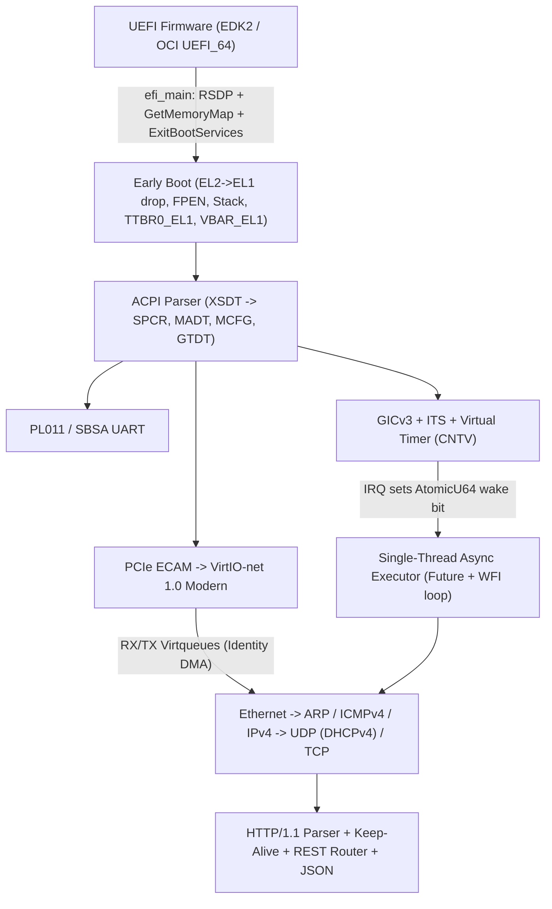

# deanOS — Architecture, Roadmap & Project Memory

A zero-dependency (`#![no_std]`, empty `[dependencies]`) Rust unikernel targeting **ARM64 (`aarch64`)** on **Oracle Cloud Infrastructure (OCI) Ampere A1 (`VM.Standard.A1.Flex`)** and local Apple Silicon QEMU (`hvf`), built completely from scratch to host an HTTP/1.1 REST API.

---

## 1. Locked Architectural Decisions

| Dimension | Decision | Rationale |
| :--- | :--- | :--- |
| **Target CPU / VM** | `aarch64` — OCI Ampere A1 (`VM.Standard.A1.Flex`) | Native speed via macOS `Hypervisor.framework` (`-accel hvf`); generous OCI Always Free tier; clean UEFI + ACPI + GICv3 + VirtIO-PCI contract. |
| **Language & Deps** | Stable Rust (`no_std` + `alloc`), **100% from scratch** | `kernel/Cargo.toml` `[dependencies]` MUST remain empty. All UEFI bindings, drivers, allocators, async executor, TCP/IP, and HTTP/JSON written in-tree. |
| **OS Model** | Single-address-space Unikernel (`EL1`) | Kernel, VirtIO-net driver, network stack, and REST server compile into one binary (`\EFI\BOOT\BOOTAA64.EFI`). No ring-3 transitions, syscalls, or ELF loader. |
| **Concurrency** | Single-core `core::future::Future` event loop | Custom `RawWaker` + atomic wake bitmap driven by GICv3 timer and VirtIO interrupts; zero stack-switching assembly; race-free `wfi` idle. |
| **State & TLS** | Stateless RAM-only; plain HTTP/1.1 in-OS | No block/filesystem layer required; HTTPS terminated externally via Cloudflare or OCI Load Balancer forwarding HTTP/1.1 over VCN/public ingress. |
| **ACPI Scope** | Static tables only — **no AML/DSDT interpreter** | Keeps ACPI parsing tractable. Consequence: PCI INTx routing (`_PRT`) lives in AML and is therefore unknowable, so interrupt delivery MUST use MSI-X via GICv3 ITS, with the timer-driven poll fallback as the de-risk path. |

---

## 2. System Architecture



### 2.1 Toolchain & Image Pipeline
- **Kernel Target**: `aarch64-unknown-uefi` on stable `rustc` (`core` + `alloc` prebuilt via `rustup target add aarch64-unknown-uefi`).
  - **Verified target spec** (`+v8a`, `target_feature="neon"`, no `+strict-align`): the compiler WILL emit FP/NEON instructions (making `CPACR_EL1.FPEN = 0b11` mandatory, not hygiene) and WILL emit unaligned accesses, which fault whenever the MMU is off (all memory is `Device-nGnRnE`).
  - **Mitigation**: build the kernel with `-C target-feature=+strict-align` (via `.cargo/config.toml`). Cost is negligible at this scale and it makes the pre-M2 / post-EL2-drop MMU-off windows safe. Keep it permanently.
- **Single-Stage Boot**: UEFI loads `\EFI\BOOT\BOOTAA64.EFI` (PE32+) into identity-mapped memory (`VA == PA`) and applies PE base relocations prior to `efi_main`.
- **Host Image Builder (`tools/mkimage`)**: In-tree standard-library Rust binary (no `mtools` or `sudo` mounts) that generates a raw disk containing Protective MBR + GPT + FAT32 EFI System Partition with `BOOTAA64.EFI`, then invokes `qemu-img convert -f raw -O qcow2` to produce a sparse 1 GiB `.qcow2` image ready for QEMU and OCI Custom Image import.
  - **ESP sizing**: FAT32 requires ≥ 65,525 clusters (~33 MiB minimum partition at 512 B clusters). Fix the ESP at **64 MiB** so the FAT32 layout is unambiguously valid; never shrink below the minimum or silently fall back to FAT16.
- **Host-Testable Core**: `net/`, `http/`, and the JSON codec are written as hardware-independent `no_std` modules behind narrow driver traits, exercised by `cargo test` on the host (std test harness). TCP state-machine and parser bugs — where the subtle failures live — get caught without QEMU round-trips.

### 2.2 Hardware Discovery Contract (QEMU ↔ OCI Ampere A1)
OCI Ampere A1 exposes **UEFI + ACPI only** (no Device Tree). All MMIO addresses MUST be discovered from `EFI_ACPI_20_TABLE_GUID` (`RSDP` → `XSDT`):

| Subsystem | Discovery Source | Hardware Interface |
| :--- | :--- | :--- |
| **Serial Console** | ACPI `SPCR` | ARM PL011 / SBSA Generic UART MMIO (connected to OCI Instance Console Connection) |
| **Interrupt Controller** | ACPI `MADT` | GICv3 Distributor (`GICD`), Redistributors (`GICR`), CPU interface (`ICC_*_EL1`), GIC ITS (`0x0F`) |
| **Timer** | Arch + `GTDT` | ARM Generic Virtual Timer (`CNTFRQ_EL0`, `CNTVCT_EL0`, `CNTV_TVAL_EL0`, `CNTV_CTL_EL0`, PPI 27) |
| **PCIe Root Complex** | ACPI `MCFG` | ECAM config space → enumerates `0x1AF4:0x1041` (Modern) / `0x1000` (Transitional) VirtIO-net |
| **Network Device** | PCI Cap `0x09` | VirtIO 1.0+ Modern PCI over 64-bit MMIO BARs (`CommonCfg`, `Notify`, `ISR`, `DeviceCfg`) |

**Local QEMU Parity Command**:
```sh
qemu-system-aarch64 \
  -M virt,gic-version=3,its=on \
  -cpu host -accel hvf -m 512M -nographic \
  -bios /opt/homebrew/share/qemu/edk2-aarch64-code.fd \
  -drive if=virtio,format=qcow2,file=target/deanos.qcow2 \
  -netdev user,id=net0,hostfwd=tcp::8080-:80 \
  -device virtio-net-pci,netdev=net0,disable-legacy=on
```

**QEMU test-matrix variants** (`scripts/run-qemu.sh` flags):
- `-M virt,virtualization=on,...` — EDK2 enters at `EL2`, exercising the `EL2 -> EL1` drop path (the default config and OCI both enter at `EL1`, so without this variant the drop code never runs until it matters).
- `-netdev vmnet-shared` (requires `sudo` on macOS) — real L2 connectivity for inbound ICMP/UDP testing; slirp user-net cannot deliver inbound ping and `hostfwd` forwards TCP only.
- Note: the boot disk attaches as virtio-blk (`0x1AF4:0x1042`); PCI enumeration must select virtio-net by **device ID** (`0x1041`), not vendor ID alone.

### 2.3 UEFI Handoff & Exception Level Normalization
1. **Handoff discipline (before `ExitBootServices()`)**: capture `EFI_LOADED_IMAGE_PROTOCOL` (image base + size — required for M2 PE W^X mapping and unobtainable afterwards) and the `RSDP` pointer from the configuration table. Then run the **retry loop**: pre-allocate an oversized memory-map buffer, and loop `GetMemoryMap` → `ExitBootServices` until success. Any allocation — **including console printing** — between the two calls invalidates the map key (`EFI_INVALID_PARAMETER`); after the first failed attempt only those two calls are legal.
2. Inspect `CurrentEL` immediately after `ExitBootServices()`:
   - If `EL2` (`CurrentEL == 2 << 2`): EL1 system registers are architecturally **UNKNOWN** from EL2, so first write a sane `SCTLR_EL1` (MMU/caches off, `EE = 0`) and a valid `SP_EL1` (SPSR selects `EL1h`). Then set `HCR_EL2.RW = 1` (AArch64 `EL1`), `CNTHCTL_EL2 |= EL1PCTEN | EL1PCEN` (untrap `EL1` timers), `CNTVOFF_EL2 = 0`, `CPTR_EL2 = 0`, `SPSR_EL2 = 0x3C5` (`EL1h`, `DAIF` masked), `ELR_EL2` = continuation address, and `eret`. Post-drop, EL1 runs MMU-off until M2 — safe only because the kernel is built with `+strict-align` (§2.1).
   - If `EL1`: continue directly (UEFI's own identity-mapped `TTBR0_EL1` tables remain live until M2 replaces them; do not reclaim `EfiBootServicesData` before the switch).
3. Enable FP/NEON at `EL1` (`CPACR_EL1.FPEN = 0b11`, `isb`) so compiler-emitted SIMD vectorization/memcpy instructions never trigger Synchronous Undefined Instruction traps.
4. Install `VBAR_EL1` 16-entry exception vector table and switch `SP` to dedicated kernel stack.

### 2.4 Memory Layout & Allocators
After `ExitBootServices()`, construct fresh 4-level, 4 KiB-granule **identity-mapped (`VA == PA`)** page tables in `TTBR0_EL1` (`MAIR_EL1`: `Attr0 = 0x00` `Device-nGnRnE`, `Attr1 = 0xFF` `Normal Write-Back`):
- **`0x0000_0000 .. 0x0000_1000`**: Unmapped null guard page.
- **Unikernel PE Sections** (parsed from loaded PE headers):
  - `.text`: `Normal WB`, `RO`, `UXN=1, PXN=0`
  - `.rodata`: `Normal WB`, `RO`, `UXN=1, PXN=1`
  - `.data` / `.bss`: `Normal WB`, `RW`, `UXN=1, PXN=1`
- **Kernel Stack**: 256 KiB `Normal WB, RW, PXN=1` with a 4 KiB unmapped lower guard page.
- **ACPI `Reclaim` / `NVS` & `EfiRuntimeServices*`**: Preserved `RO` / mapped per descriptor.
- **Usable RAM (`EfiConventionalMemory` + `EfiBootServicesCode/Data`)**: `Normal WB, RW, PXN=1`.
- **MMIO Regions (`SPCR`, `MADT`, `MCFG`, PCI 64-bit BAR window)**: `Device-nGnRnE, RW, PXN=1`.
- **Physical Frame Allocator**: Two-level bitmap tracking 4 KiB physical frames; used for page tables and contiguous VirtIO DMA descriptors/buffers (`DMA_addr == virt_addr`).
- **Heap Allocator (`#[global_allocator]`)**: Fixed size-class segregated slab (`16 B .. 2048 B`) backed by a coalescing page-run free-list for larger allocations.

### 2.5 Single-Thread Async Executor & Interrupt Model
- **Task Table**: Fixed array/slab of `Option<Pin<Box<dyn Future<Output = ()>>>>` paired with an atomic wake bitmap (`[AtomicU64; N]`).
- **`Waker`**: Static `RawWakerVTable` storing `task_id` in the data pointer; `wake` / `wake_by_ref` executes an atomic `fetch_or(..., Release)` on the wake bitmap (ISR-safe, lock-free, allocation-free).
- **Race-Free `WFI` Loop**:
  1. Drain wake bitmap via `swap(0, Acquire)` and poll each runnable task.
  2. Mask IRQs (`msr daifset, #2`).
  3. Re-check wake bitmap and expired timer deadlines; if none pending, execute `dsb sy; wfi` (wakes on pending GIC IRQ even while `PSTATE.I == 1`).
  4. Unmask IRQs (`msr daifclr, #2`); `VBAR_EL1` IRQ vector acknowledges `ICC_IAR1_EL1`, wakes waiting timer/VirtIO tasks, signals `ICC_EOIR1_EL1`, and returns to step 1.

### 2.6 Networking & HTTP/1.1 Stack
- **VirtIO-net 1.0 Modern**: Negotiate `VIRTIO_F_VERSION_1`, `VIRTIO_NET_F_MAC`, `VIRTIO_NET_F_STATUS`. Split RX/TX virtqueues with pre-posted 2 KiB RX buffers; GICv3 ITS MSI-X interrupt delivery (with timer-driven NAPI poll fallback for bring-up resilience).
  - **Wire format**: with `VIRTIO_F_VERSION_1`, every RX and TX buffer carries a 12-byte `virtio_net_hdr` (incl. `num_buffers`) even with all offload features unnegotiated — RX buffer sizing and TX framing must account for it; checksums stay in software (never negotiate `VIRTIO_NET_F_CSUM`/`GUEST_CSUM`).
- **OCI VCN Rules**:
  - **DHCPv4 Required**: Acquire VNIC IPv4, subnet mask, and default gateway via DHCP (`UDP 68 -> 67`).
  - **MTU / MSS Clamp**: Ignore OCI's `MTU = 9000` jumbo advertisement for outbound sizing—cap Ethernet payload to `1500 B` and advertise **TCP `MSS = 1460`** on `SYN`/`SYN-ACK` so public Internet / Load Balancer paths never blackhole on PMTUD.
- **L2–L4**: Ethernet II, bounded ARP cache + pending packet queue, IPv4 (no fragmentation), ICMPv4 Echo reply, UDP (DHCPv4), full TCP state machine (`LISTEN`, `SYN_RCVD`, `ESTABLISHED`, `FIN_WAIT_1/2`, `CLOSE_WAIT`, `LAST_ACK`, `TIME_WAIT`) with ring buffers, RTO timer wheel, and `CNTVCT_EL0`-seeded SipHash ISNs.
- **L7 REST Server**: Streaming HTTP/1.1 parser (`GET`, `POST`, `PUT`, `DELETE`, `Content-Length`, `Connection: keep-alive`, idle/header timeouts), zero-allocation segment router (`/health`, `/api/...`), and a recursive-descent JSON parser + buffered serializer.

---

## 3. Planned Workspace Layout

```text
deanOS/
├── PLAN.md                 # Architecture, roadmap, progress & learnings memory
├── Cargo.toml              # Workspace root (kernel + tools/mkimage)
├── scripts/
│   └── run-qemu.sh         # Builds BOOTAA64.EFI + deanos.qcow2 and launches QEMU (hvf)
├── kernel/
│   ├── Cargo.toml          # [dependencies] = {} (strictly empty)
│   └── src/
│       ├── main.rs         # efi_main entry, boot orchestration, panic handler
│       ├── uefi.rs         # Raw UEFI SystemTable, GetMemoryMap, ExitBootServices
│       ├── acpi.rs         # RSDP/XSDT validation + SPCR, MADT, MCFG, GTDT parsers
│       ├── arch/           # EL2->EL1 drop, VBAR_EL1 asm, TTBR0_EL1 MMU, GICv3/ITS, CNTV timer
│       ├── mm/             # 4 KiB bitmap frame allocator, slab/free-list GlobalAlloc
│       ├── drivers/        # PL011 UART, PCIe ECAM + BAR allocator, VirtIO 1.0 PCI + net
│       ├── runtime/        # RawWaker executor, timer wheel, async channels/wakers
│       ├── net/            # eth, arp, ipv4, icmp, udp, dhcp, tcp
│       └── http/           # request parser, response writer, router, json
└── tools/
    └── mkimage/            # Host Rust tool: GPT + FAT32 ESP + qemu-img -> .qcow2
```

---

## 4. Milestone Roadmap

### M1 — UEFI Boot, ACPI Discovery, Serial Console & OCI Image Builder
- [ ] Initialize Cargo workspace (`kernel` + `tools/mkimage`), install `aarch64-unknown-uefi` target, and add `.cargo/config.toml` with `-C target-feature=+strict-align` for the kernel (§2.1).
- [ ] Implement raw UEFI FFI (`SystemTable`, `SimpleTextOutput`, `ConfigurationTable`, `LoadedImageProtocol`, `GetMemoryMap`, `ExitBootServices`) including the map-key **retry loop** with a print-free window (§2.3 step 1).
- [ ] Parse ACPI `RSDP` → `XSDT` → `SPCR`, `MADT`, `MCFG`, `GTDT` before/across boot handoff.
- [ ] Implement `EL2 -> EL1` normalization (sane `SCTLR_EL1`/`SP_EL1` before `eret`), `CPACR_EL1.FPEN`, and PL011/SBSA UART driver (`core::fmt::Write` logger).
- [ ] Build `tools/mkimage` (GPT + 64 MiB FAT32 ESP + `qemu-img` `.qcow2`) and `scripts/run-qemu.sh` (incl. `virtualization=on` and `vmnet-shared` variants).
- **Gate**: Boots in QEMU (`hvf`) printing memory map summary and discovered ACPI hardware bases over PL011 — under both `virtualization=off` (EL1 entry) and `virtualization=on` (EL2-drop path); `deanos.qcow2` ready for OCI Custom Image import.

### M2 — MMU Page Tables, Frame/Heap Allocators & Exception Vectors
- [ ] Install 16-entry `VBAR_EL1` vector table with full register/ESR/FAR/ELR crash diagnostics over UART.
- [ ] Build physical 4 KiB bitmap frame allocator from UEFI memory map (excluding kernel image, stack, ACPI tables).
- [ ] Construct 4-level identity-mapped `TTBR0_EL1` page tables (null guard, stack guard, PE W^X, `Device-nGnRnE` MMIO) and switch `TTBR0_EL1` + `TCR_EL1` + `MAIR_EL1` + `SCTLR_EL1`.
- [ ] Implement slab + free-list `#[global_allocator]` and enable `extern crate alloc`.
- **Gate**: `Vec`/`String`/`Box` stress test passes; deliberate null dereference or RO write prints decoded `ESR_EL1` / `FAR_EL1` fault dump cleanly.

### M3 — GICv3, Virtual Timer & Single-Thread Async Executor
- [ ] Initialize GICv3 Distributor (`GICD`), Redistributor (`GICR`), and system-register CPU interface (`ICC_*_EL1`).
- [ ] Configure ARM Generic Virtual Timer (`CNTV`) one-shot/periodic IRQ (PPI 27) and monotonic clock utilities.
- [ ] Implement fixed-slot `Future` executor, atomic `RawWaker` bitmap, async `sleep()`, and race-free `DAIF`/`wfi` idle loop.
- **Gate**: Multiple concurrent async tasks wake accurately at independent timer intervals while host QEMU process idles near 0% CPU during `wfi`.

### M4 — PCIe ECAM & VirtIO-net 1.0 Modern Driver
- [ ] Enumerate PCIe bus via `MCFG` ECAM, selecting virtio-net by device ID `0x1041` (skip the virtio-blk boot disk `0x1042`); assign/validate 64-bit MMIO BARs if unassigned by firmware and enable Bus Master + Memory Space.
- [ ] Parse VirtIO PCI vendor capabilities (`CommonCfg`, `Notify`, `ISR`, `DeviceCfg`) and complete VirtIO 1.0 device initialization handshake.
- [ ] Allocate physically contiguous split virtqueues (RX0, TX0), populate RX buffers (accounting for the 12-byte `virtio_net_hdr`), and wire GICv3 ITS MSI-X (plus timer poll fallback) into async RX/TX wakers. Bring the stack up on the poll fallback FIRST; land ITS (PROPBASER/PENDBASER, device table, ITT, command queue) as a separate step — it is the hardest single chunk in the project.
- **Gate**: Logs NIC MAC address, receives live Ethernet broadcasts/frames, and transmits valid Ethernet frames verified on host tap/user-net capture.

### M5 — Ethernet, ARP, IPv4, ICMPv4, UDP & DHCPv4 Client
- [ ] Implement zero-copy network buffer views and big-endian wire checksums (ones'-complement RFC 1071).
- [ ] Implement Ethernet II demux, bounded ARP cache + pending TX resolution queue, IPv4 header validation, and ICMPv4 Echo reply.
- [ ] Implement UDP datagram TX/RX and DHCPv4 state machine (`DISCOVER` → `OFFER` → `REQUEST` → `ACK` + lease renewal timer); L3/L4 logic covered by host-side `cargo test` (§2.1).
- **Gate**: Acquires IPv4 + gateway automatically in QEMU and OCI VCN. Echo-reply verified via `vmnet-shared` inbound `ping` (slirp user-net cannot deliver inbound ICMP and `hostfwd` is TCP-only), with final confirmation by live `ping` against the OCI instance in M7.

### M6 — From-Scratch TCP Transport
- [ ] Implement TCP header/options parser (`MSS = 1460`), SipHash ISN generator, and socket table keyed by 4-tuple.
- [ ] Implement full connection state machine (`LISTEN` through `TIME_WAIT`), per-connection RX/TX circular buffers, and async `TcpListener` / `TcpStream` traits.
- [ ] Implement RTO retransmission timer wheel, duplicate-ACK handling, window clamping, minimal congestion control (slow start + halve-on-loss `cwnd` — pure window-limited blasting misbehaves on lossy Internet paths), and RST/timeout cleanup.
- [ ] Validate the state machine with host-side `cargo test` (segment-level unit tests: simultaneous close, retransmit sequencing, out-of-window handling) before QEMU integration.
- **Gate**: Sustains multi-megabyte streaming transfers and 100+ rapid sequential/concurrent `nc` connections without buffer leaks or stuck sockets.

### M7 — HTTP/1.1 Server, Router, JSON Codec & OCI End-to-End Proof
- [ ] Implement streaming HTTP/1.1 request parser (`Content-Length`, `Connection: keep-alive`, header/body limits, read/idle timeouts) and buffered response writer.
- [ ] Implement typed path/parameter router (`GET /health`, sample REST CRUD endpoints in RAM) and recursive-descent JSON parser/serializer.
- [ ] Deploy `.qcow2` to OCI `VM.Standard.A1.Flex` (1 OCPU — see §5.2) with a VCN security-list/NSG ingress rule for TCP 80 (and ICMP for the ping gate), behind external TLS proxy (Cloudflare / OCI Load Balancer); verify end-to-end HTTPS → HTTP REST traffic.
- **Gate**: Passes `curl` functional suite and concurrent keep-alive benchmark locally and on live Oracle Cloud Ampere A1 VM.

---

## 5. Progress, Learnings & Project Memory

> **Maintenance Rule**: Update this section at the end of every milestone or debugging session with status changes, newly verified hardware facts, and non-obvious bugs/fixes.

### 5.1 Progress Summary
- **Current Phase**: M1–M7 complete and verified locally (QEMU hvf + TCG, EL1 + EL2 entry paths).
- **Next Action**: OCI deployment — upload `target/deanos.qcow2`, import as Custom Image (UEFI_64, paravirtualized), launch `VM.Standard.A1.Flex` (1 OCPU), VCN ingress TCP 80 + ICMP, verify live.

| Milestone | Status | Date | Verification Evidence |
| :--- | :--- | :--- | :--- |
| **M0 — Architecture & Spec** | Done | 2026-10-31 | `PLAN.md` written; local toolchain & firmware verified |
| **M1 — Boot, ACPI & Serial** | Done | 2026-10-31 | `M1 GATE OK` on hvf+TCG, EL1 & EL2 entry; ACPI bases + memory map on PL011 |
| **M2 — MMU, Heap & Exceptions** | Done | 2026-10-31 | `M2 GATE OK`; Vec/String/Box stress; null-deref dumps `EC=0x25 ESR=0x96000006 FAR=0x10` |
| **M3 — GICv3, Timer & Executor** | Done | 2026-10-31 | `M3 GATE OK`; 3 tickers exact counts over 2001 ms; QEMU 0.0–0.1% CPU at idle |
| **M4 — PCIe & VirtIO-net 1.0** | Done | 2026-10-31 | MAC read, ARP broadcast TX + unicast reply RX, confirmed in host pcap (poll-mode RX; ITS MSI-X deferred as optimization) |
| **M5 — L2/L3 + DHCPv4** | Done | 2026-10-31 | DHCP bound in 50 ms (full DORA in pcap); ICMP echo RTT < 1 ms; 10 host unit tests |
| **M6 — TCP Transport** | Done | 2026-11-01 | 100 sequential + 20 concurrent conns, 4 MiB echo @ ~45 MiB/s, 0 faults; 12 segment-level host tests |
| **M7 — HTTP/1.1 REST (local)** | Done | 2026-11-01 | curl CRUD suite + keep-alive (1 connect / 5 reqs); 1600 reqs @ 4549 req/s over 16 conns; 11 HTTP/JSON host tests; EL2-path regression green |
| **M8 — OCI Live Deployment** | Pending | — | — |

### 5.2 Environment & Hardware Memory (Verified Facts)
- **Workstation**: macOS `arm64` (`darwin 27.2.0`).
- **Installed Binaries Verified**:
  - `rustc` / `cargo` / `rustup` (`/Users/mkotik/.cargo/bin/*`); currently installed target: `aarch64-apple-darwin` (`aarch64-unknown-uefi` needs `rustup target add aarch64-unknown-uefi`).
  - `clang` (`/usr/bin/clang`).
  - `qemu-system-aarch64` & `qemu-img` (`/opt/homebrew/bin/*`).
  - UEFI Firmware: `/opt/homebrew/share/qemu/edk2-aarch64-code.fd` (64 MiB raw flash image present).
  - Note: `mtools` (`mformat`/`mcopy`) is **not** installed—confirmed decision to build FAT32 ESP + GPT directly in `tools/mkimage` in pure Rust without external disk-formatting tools or `sudo`.
- **`aarch64-unknown-uefi` Target Spec (verified 2026-10-31 via `rustc --print cfg` / target-spec-json)**: features `+v8a` only; `target_feature="neon"` **enabled** (hard-float, so `CPACR_EL1.FPEN = 0b11` is mandatory) and `+strict-align` **absent** (so the kernel build must add `-C target-feature=+strict-align` for MMU-off safety — §2.1).
- **OCI Ampere A1 (`VM.Standard.A1.Flex`) Invariants**:
  - Custom Image import format: `.qcow2`, UEFI_64 firmware, Paravirtualized launch mode.
  - Firmware exposes **ACPI 2.0+ (`XSDT`)**, not Device Tree.
  - Serial output goes to the UART described in ACPI `SPCR` and streams over OCI Instance Console Connection.
  - Primary VNIC requires **DHCPv4** to activate VCN routing lease and advertises `MTU = 9000` locally while external Internet ingress enforces `MTU = 1500`.
  - Provision with **1 OCPU**: the executor is single-core; secondary vCPUs would sit parked (PSCI never invoked) while consuming Always Free quota.
  - Inbound traffic requires explicit VCN security-list/NSG ingress rules (TCP 80, ICMP echo).

### 5.3 Learnings & Hardware Quirks Log
- **[2026-10-31] UEFI Exception Level (`EL2` vs `EL1`)**: Depending on hypervisor flags (QEMU `virt` configs vs KVM/HVF), UEFI may enter `efi_main` at either `EL2` or `EL1`. Always branch on `CurrentEL` after `ExitBootServices()` and drop cleanly to `EL1h` rather than assuming `EL1`.
- **[2026-10-31] ARM64 NEON/FP Trap (`CPACR_EL1`)**: Even in integer-only Rust code, LLVM emits SIMD/FP register operations unless disabled or permitted; setting `CPACR_EL1.FPEN = 0b11` + `isb` during early `EL1` init prevents mysterious `ESR_EL1 EC=0x07` traps. **Verified** against the actual target spec (§5.2): `aarch64-unknown-uefi` enables NEON and does not soft-float, so this is strictly required.
- **[2026-10-31] `ExitBootServices` Map-Key Invalidation**: Any boot-services allocation — including printing via `SimpleTextOutput` — between `GetMemoryMap` and `ExitBootServices` stales the map key and fails the call with `EFI_INVALID_PARAMETER`. Use a retry loop with a print-free window; after the first failed attempt only `GetMemoryMap`/`ExitBootServices` are legal.
- **[2026-10-31] QEMU user-net (slirp) Test Limits**: slirp cannot deliver inbound ICMP to the guest and `hostfwd` forwards TCP only — inbound `ping` gates need `vmnet-shared` (sudo) or the live OCI instance. Also, QEMU-virt default (`virtualization=off`) and OCI both enter `efi_main` at `EL1`, so the `EL2 -> EL1` drop path only executes under `-M virt,virtualization=on`.
- **[2026-10-31] Keep MMU Enabled (`Normal` vs `Device` Memory)**: Disabling `SCTLR_EL1.M` treats all memory accesses as `Device-nGnRnE`, causing any compiler-generated unaligned load/store in Rust slices/structs to raise an Alignment Fault. Maintain `Normal Write-Back` mappings for RAM and `Device-nGnRnE` strictly for MMIO.
- **[2026-10-31] Race-Free `WFI` on ARM64**: Unlike x86 `sti; hlt` shadow semantics, ARM64 `wfi` wakes whenever a GIC interrupt is pending at the CPU interface even when `PSTATE.I == 1` (`DAIF` IRQ masked). Masking IRQs before checking the wake bitmap, executing `wfi`, and unmasking immediately after eliminates lost-wakeup races.
- **[2026-10-31] OCI Jumbo Frame PMTUD Blackhole**: OCI VCN DHCP offers `MTU 9000`, which works intra-VCN but stalls TCP connections from external clients if larger segments hit the 1500-byte Internet Gateway without working ICMP fragmentation-needed path delivery. Hard-clamping TX frame size to `1500` and TCP `MSS = 1460` avoids this completely.
- **[2026-10-31] Prebuilt `core` Is NOT strict-align**: `-C target-feature=+strict-align` only covers in-tree crates; rustup's precompiled `core`/`compiler_builtins` emit unaligned loads (seen: alignment Data Abort `ESR=0x96000021` inside `core::fmt` while MMU off). Fixes shipped: (a) alignment-safe `memcpy/memset/memmove/memcmp` strong-symbol overrides in `mm/memops.rs`, (b) raw `puts/put_hex/put_dec` (no `core::fmt`) for all pre-MMU output — `kprintln!` is legal only after `SCTLR_EL1.M=1`.
- **[2026-10-31] QEMU hvf Matrix**: QEMU 11.0.3's hvf crashed at vcpu init on this macOS (SMCR_EL1 sysreg-map assert) — fixed by Homebrew upgrade to 11.1.3. Apple's in-kernel vGIC has **no ITS**: run `-M virt,its=on` with `kernel-irqchip=off` (emulated GICv3) for OCI parity.
- **[2026-11-01] slirp hostfwd Accept-Backlog Bursts**: 20 simultaneous host connects overflow QEMU user-net's tiny hostfwd listen backlog — host clients see RST while the guest-side pcap shows zero drops (7/120 connections never reached the guest). Stagger connects ~5 ms or retry once in test harnesses; NOT a guest-stack issue.
- **[2026-11-01] TCP `snd_una` on Passive Open**: when the handshake-completing ACK moves SynRcvd→Established, `snd_una` must advance over the SYN's sequence slot or all later flight-size math is off by one (and real ACKs misclassify as progress/dup). Caught by host-side segment tests before it ever hit QEMU.
- **[2026-11-01] Poll-Mode RX Is Plenty (for now)**: 1 ms used-ring polling sustains 4549 req/s HTTP keep-alive and ~45 MiB/s TCP echo under hvf. ITS MSI-X (GICv3 LPIs) remains a deferred optimization, per M4's bring-up-on-poll-first plan.

### 5.4 Session Log
- **2026-10-31 (Session 1)**:
  - Clarified project scope: `aarch64` OCI Ampere A1 target, stable Rust `no_std`, zero third-party crates, single-address-space unikernel, single-thread `Future` event loop, stateless RAM + external TLS proxy.
  - Audited local macOS `arm64` toolchain (`rustc`, `qemu-system-aarch64`, `qemu-img`, `edk2-aarch64-code.fd`).
  - Authored `PLAN.md` with full subsystem architecture, 7-milestone roadmap, and persistent project memory/learnings sections.
- **2026-10-31 (Session 2 — Plan Review)**:
  - Verified `aarch64-unknown-uefi` target spec on the installed toolchain: NEON enabled, no `+strict-align` → adopted mandatory `-C target-feature=+strict-align` kernel build flag.
  - Hardened the plan: `ExitBootServices` retry loop + print-free window and pre-exit `LoadedImageProtocol` capture (§2.3); `SCTLR_EL1`/`SP_EL1` initialization before the `EL2 -> EL1` `eret`; fixed 64 MiB ESP (FAT32 ≥ 65,525-cluster minimum); 12-byte `virtio_net_hdr` wire-format note and device-ID-based NIC selection; minimal TCP congestion control added to M6.
  - Made the no-AML decision explicit (§1) — it is why MSI-X/ITS is mandatory (INTx routing lives in AML `_PRT`); M4 now brings the stack up on poll fallback before landing ITS.
  - Added test-matrix variants (`virtualization=on` for the EL2 path, `vmnet-shared` for inbound ICMP), restated the M5 ping gate around slirp's limits, and committed to host-side `cargo test` for `net/`/`http/`/JSON modules.
  - Recorded OCI ops details: 1 OCPU shape, VCN ingress rules for TCP 80 + ICMP.
- **2026-10-31 → 2026-11-01 (Session 3 — Implementation M1–M7)**:
  - Built the entire unikernel: UEFI handoff (+retry loop, LoadedImage), ACPI parsers, EL2→EL1 drop, PL011 console, `mkimage` (pure-Rust GPT+FAT32+qcow2), identity MMU with PE W^X + stack guard, frame/slab allocators, GICv3 + CNTV + wake-bitmap executor with race-free `wfi` idle, PCIe ECAM + virtio-net modern (poll RX), full L2–L4 stack (ARP/IPv4/ICMP/UDP/DHCP), from-scratch TCP (RTO, dup-ACK fast-rtx, slow start, SipHash ISNs), HTTP/1.1 + JSON REST server.
  - Test infrastructure: `tools/netharness` compiles kernel `net/`+`http/` sources verbatim on the host — 33 unit/segment tests; QEMU gates M1–M7 all green on hvf (EL1) and TCG (`virtualization=on`, EL2); host stress: 100 sequential + 20 concurrent conns, 4 MiB echo ~45 MiB/s, 1600 keep-alive reqs @ 4549 req/s, zero kernel faults.
  - Deviation from M4 as written: ITS MSI-X not yet landed (poll fallback is primary); tracked as deferred optimization.
  - New learnings logged: prebuilt-core alignment, QEMU 11.0.3 hvf breakage, hvf vGIC/ITS, slirp accept-backlog bursts, TCP passive-open `snd_una`.
